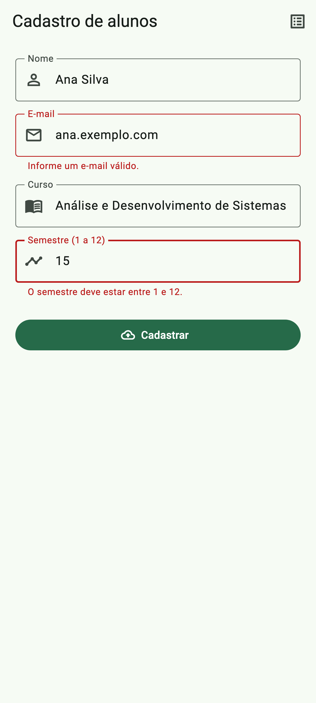
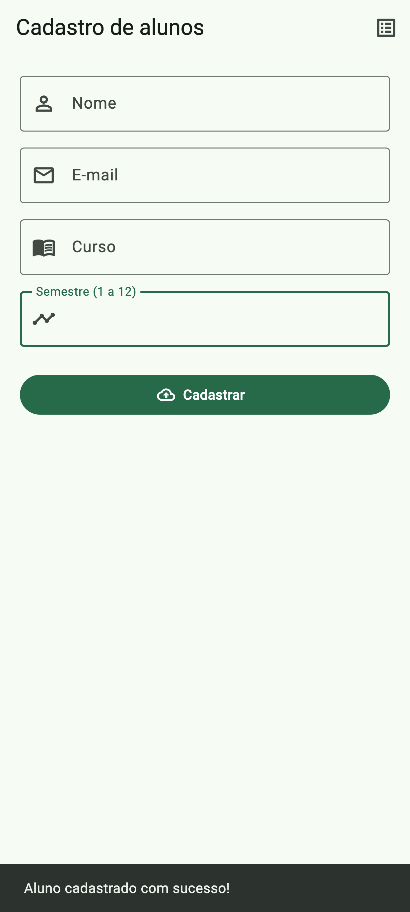
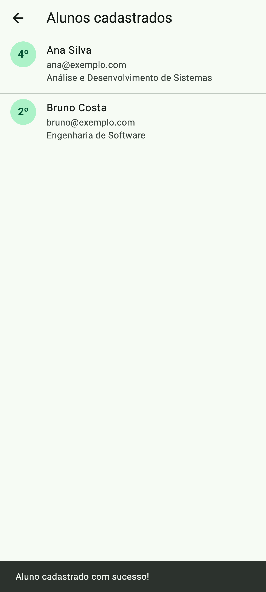
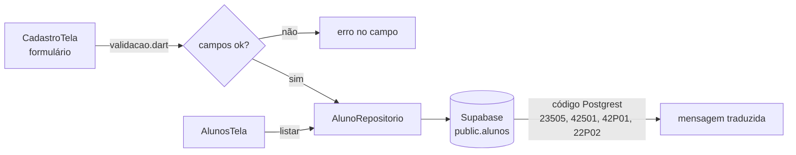
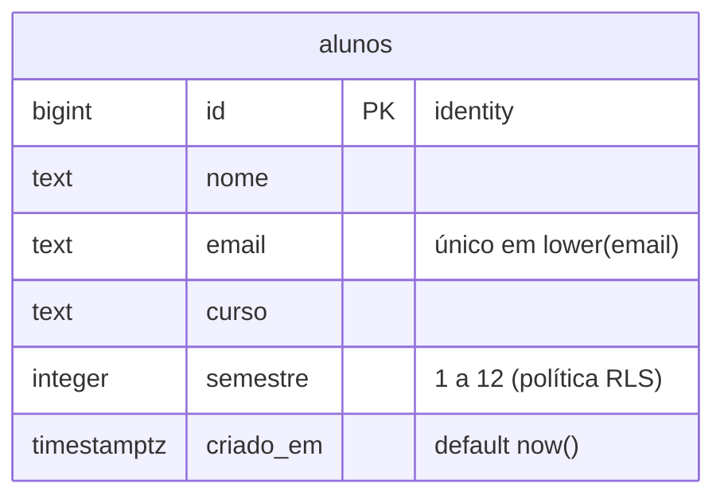

# Aula 08: Flutter + Supabase, cadastro de alunos

Disciplina **Tecnologias Móveis e Híbridas** (ADS, Senac São José dos Pinhais). Os demais exercícios da matéria estão em [flutter-class](https://github.com/PeSzpak/flutter-class).

Formulário com nome, e-mail, curso e semestre que grava na tabela `public.alunos` do Supabase pelo pacote `supabase_flutter`.

- **Validação no app antes do envio:** campos vazios, e-mail inválido e semestre fora de 1 a 12.
- **INSERT:** `Supabase.instance.client.from('alunos').insert({...})`.
- **Retorno:** aviso de sucesso ou erro, com os erros comuns do slide traduzidos (permissão/RLS, tabela inexistente, tipo inválido, sem internet).
- **Extensão 1:** tela "Alunos cadastrados" com SELECT (ícone no topo).
- **Extensão 2:** e-mail duplicado bloqueado no banco por um índice único em `lower(email)`; o app mostra "Este e-mail já está cadastrado."
- **Extensão 3:** como proteger em produção, abaixo.

| Validação | Cadastro aceito | Alunos cadastrados |
|---|---|---|
|  |  |  |

As telas foram geradas pelos testes de golden (`prints/prints_test.dart`) com o repositório em memória e dados fictícios, sem tocar no Supabase.

## Como funciona



O app depende só da interface `AlunoRepositorio` (`cadastrar` e `listar`). Em produção ela é o `SupabaseAlunoRepositorio`; nos testes, uma versão em memória. Os erros do Postgrest viram mensagens em português (e-mail repetido, RLS, tabela inexistente, tipo errado, sem internet).



**Stack:** Flutter (Material 3), Dart, `supabase_flutter`, Postgres com RLS.

## Estrutura

```
lib/
  main.dart               inicializa o Supabase a partir do --dart-define
  cadastro_tela.dart      formulário e envio
  alunos_tela.dart        listagem (SELECT)
  validacao.dart          regras de nome, e-mail e semestre
  aluno.dart              modelo + toMap/fromMap
  aluno_repositorio.dart  interface e implementação Supabase
supabase/alunos.sql       tabela, índice único e políticas RLS
prints/                   capturas (testes de golden)
test/widget_test.dart     testes com repositório em memória
```

## Como rodar

1. No SQL Editor do Supabase, rode `supabase/alunos.sql`.
2. Copie `supabase.example.json` para `supabase.json` e preencha com a URL do projeto e a chave publicável (Project Settings → API Keys). O `supabase.json` fica fora do git.
3. `flutter run --dart-define-from-file=supabase.json`
4. Cadastre um aluno fictício e confira a linha no Table Editor → `public.alunos`.

## Testes

`flutter test` roda 9 testes com um repositório em memória no lugar do Supabase: campos vazios, e-mail inválido, semestre 15, cadastro válido, e-mail repetido, sem internet e listagem. As capturas estão em [`prints/`](prints).

## Extensão 3: como proteger a tabela em produção

A política da aula deixa qualquer pessoa com a chave pública inserir e ler alunos. A chave publicável vai dentro do app, então qualquer um consegue extraí-la. Em produção:

1. **Exigir login (Supabase Auth)** e trocar o papel `anon` por `authenticated` nas políticas.
2. **Ligar cada linha ao dono:** coluna `user_id uuid default auth.uid()` e políticas `using (user_id = auth.uid())`, para cada aluno ver e editar só o próprio cadastro.
3. **Não liberar SELECT geral:** e-mail é dado pessoal (LGPD). A listagem completa ficaria para um papel de secretaria, verificado por uma claim no JWT ou por uma tabela de perfis.
4. **Validar no banco também:** `check (semestre between 1 and 12)`, `check (email ~* '^[^@\s]+@[^@\s]+\.[^@\s]+$')` e o índice único; o app pode ser burlado.
5. **Nunca colocar a `service_role` no app**, e usar uma Edge Function quando alguma operação precisar de privilégio maior.

## Situação da gravação real

O código está pronto, mas ainda não gravou em um banco real. O projeto `flutter-class` do Supabase está pausado; depois de reativá-lo, basta rodar o SQL acima e o passo 3.
